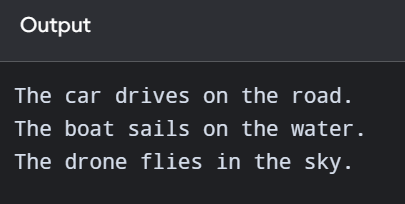

## Answer the following questions:
### What is duck typing, as explained in the video?
Aside from inheritance, another method to observe polymorphism in a program is through duck typing. In this process, the object must have the minimum needed attributes or methods. This can be better understood using its tagline, "If it walks like a duck and quacks like a duck, it's a duck."

### What did the Car class need to have so it could work inside the same loop as Dog and Cat, even if it does not inherit from the Animal class?
In the video, a loop was performed involving the classes Cat and Dog to execute all methods to speak. In code 2.2, the Car class needed the method to move for it to work in the same loop as the video demonstrated.

### [Python Code](https://github.com/betdeleon-crypto/9berylliumcs3/blob/8940c32a3bd5d22e55ff531232738092883c913a/quarter%202/sg11_polymorphism_activity2.py)

Sample Output

### How does the code in 2.2 demonstrate polymorphism?
The written code above helps demonstrate polymorphism because it allows different objects to execute the same method call depending on the code that envelops it. To be able to achieve this, each class to be involved must have the necessary attributes or methods to execute the code properly.
